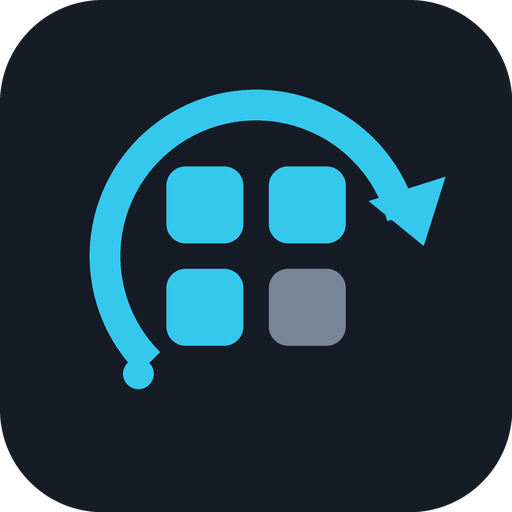

# DSH Plugin Bulk Update

<p align="center"></p>

[English](#english) · [Русский](#русский) · [简体中文](#简体中文) · [日本語](#日本語) · [Español](#español) · [Français](#français) · [Deutsch](#deutsch) · [Português](#português)

<a id="english"></a>

## English

A DeepSeek Harness sidebar plugin for checking installed registry plugins for updates and applying only the versions you select. It uses DSH's built-in plugin manager; it does not install updates automatically.

### Features
- Check installed registry packages for available compatible bundle versions.
- Review candidates in one list. Candidates are selected by default; uncheck any you want to skip.
- Apply selected updates sequentially through DSH's plugin manager.
- Continue with the remaining selections if one update fails; failed items remain in the list.
- Localized interface and plugin description for English, Simplified Chinese, Japanese, Spanish, French, German, Russian, and Portuguese. Other locale variants use their language's translation when available (for example, `zh-CN` uses `zh`); unsupported languages fall back to English.

### Install

Install from the DSH CLI:

```sh
dsh plugin --profile web add dsh-plugin-bulk-update
```

If your DSH build offers plugin installation in its UI, you can also add the published package from the plugin manager.

### Use
1. Open **Updates** in the left sidebar.
2. Select **Check** to scan installed packages.
3. Uncheck any candidates you do not want to update.
4. Select **Update selected** and allow the operation to finish.

The panel reports how many updates were found, skipped, or could not be checked. Updates run one at a time. DSH may require a restart for some package changes to take effect.

### Scope and limitations
- Checks packages for which DSH reports `update: 'registry'`.
- Git, local-path, tarball, and official packages are not included in the registry version scan.
- Checking and applying updates are separate user actions; nothing is installed automatically.
- Availability depends on the configured registry being reachable and on DSH's plugin manager returning compatible bundle versions.
- This updater deliberately skips itself; update it separately through the DSH plugin manager so it cannot unload its own UI during replacement.
- Some package changes may require a DSH restart; this plugin does not restart the application automatically.

### Compatibility

Declared DSH range: `>=0.2.2-rc.2 <0.3.0-0`. This permits newer releases in the 0.2 line instead of pinning one RC. Build dependencies remain pinned to `0.2.2-rc.2`; source typechecks and host compatibility checks pass with `rc.2` and `rc.3`. Future releases in the range are not individually tested; DSH 0.3 prereleases and later require a new review.

### Development

From this package directory:

```sh
pnpm install
pnpm run typecheck
pnpm run build
```

---

<a id="русский"></a>

## Русский

Плагин DeepSeek Harness добавляет в боковую панель проверку установленных registry-плагинов и выборочное применение обновлений. Он использует встроенный менеджер плагинов DSH и не устанавливает обновления автоматически.

### Возможности
- Проверяет registry-пакеты на наличие доступных совместимых версий bundle.
- Показывает кандидаты в одном списке. По умолчанию они отмечены; снимите отметку с тех, которые обновлять не нужно.
- Последовательно применяет выбранные обновления через менеджер плагинов DSH.
- При ошибке обновления одного пакета продолжает обработку остальных; неудачные элементы остаются в списке.
- Интерфейс и подпись плагина локализованы на английский, упрощённый китайский, японский, испанский, французский, немецкий, русский и португальский. Для неподдерживаемых языков используется английский.

### Установка

Установите его из CLI DSH:

```sh
dsh plugin --profile web add dsh-plugin-bulk-update
```

Если в вашей сборке DSH доступна установка через интерфейс, опубликованный пакет также можно добавить через менеджер плагинов.

### Использование
1. Откройте **Обновления** в левой боковой панели.
2. Нажмите **Проверить**, чтобы просканировать установленные пакеты.
3. Снимите отметки с обновлений, которые устанавливать не нужно.
4. Нажмите **Обновить выбранные** и дождитесь завершения операции.

Панель показывает, сколько обновлений найдено, пропущено или не удалось проверить. Обновления выполняются по одному. Для применения изменений некоторых пакетов может потребоваться перезапуск DSH.

### Область проверки и ограничения
- Проверяются пакеты, для которых DSH сообщает `update: 'registry'`.
- Git-пакеты, пакеты из локальных путей, tarball-пакеты и официальные пакеты не входят в registry-проверку версий.
- Проверка и применение обновлений — отдельные действия пользователя; автоматической установки нет.
- Доступность обновлений зависит от доступности настроенного registry и от совместимых версий bundle, возвращённых менеджером плагинов DSH.
- Плагин намеренно пропускает обновление самого себя; обновляйте его отдельно через менеджер плагинов DSH, чтобы замена пакета не выгружала его интерфейс.
- Для применения некоторых изменений может потребоваться перезапуск DSH; плагин не перезапускает приложение автоматически.

### Совместимость

Заявленный диапазон DSH: `>=0.2.2-rc.2 <0.3.0-0`. Вместо привязки к одному RC допускаются новые выпуски ветки 0.2. Зависимости сборки закреплены на `0.2.2-rc.2`; проверка типов исходников и штатная проверка совместимости проходят с `rc.2` и `rc.3`. Будущие версии внутри диапазона отдельно не проверены; предварительные версии DSH 0.3 и более новые ветки требуют повторной проверки.

### Разработка

Из каталога пакета выполните:

```sh
pnpm install
pnpm run typecheck
pnpm run build
```

---

<a id="简体中文"></a>

## 简体中文

这是一款 DeepSeek Harness 侧边栏插件，用于检查已安装的 registry 插件并由用户选择要应用的更新。插件使用 DSH 内置的插件管理器，不会自动安装更新。

### 功能
- 检查已安装的 registry 软件包是否有可用且兼容的 bundle 版本。
- 在一个列表中查看候选更新。候选项默认勾选；取消勾选即可跳过。
- 通过 DSH 插件管理器逐个应用所选更新。
- 某个更新失败时继续处理其他所选项；失败的项目会保留在列表中。
- 界面和插件简介提供英语、简体中文、日语、西班牙语、法语、德语、俄语和葡萄牙语版本；其他语言回退到英语。

### 安装

通过 DSH CLI 安装：

```sh
dsh plugin --profile web add dsh-plugin-bulk-update
```

如果当前 DSH 版本支持图形界面安装，也可以在插件管理器中添加已发布的软件包。

### 使用方法
1. 在左侧边栏打开 **更新**。
2. 点击 **检查**，扫描已安装的软件包。
3. 取消勾选不希望更新的项目。
4. 点击 **更新所选项**，并等待操作完成。

面板会显示找到、跳过或检查失败的更新数量。更新按顺序逐个执行。部分软件包变更可能需要重启 DSH 才能生效。

### 检查范围与限制
- 仅检查 DSH 标记为 `update: 'registry'` 的软件包。
- Git、本地路径、tarball 和官方软件包不在 registry 版本检查范围内。
- 检查与应用更新是两个独立的用户操作，不会自动安装更新。
- 更新信息取决于配置的 registry 是否可访问，以及 DSH 插件管理器能否返回兼容的 bundle 版本。
- 部分更新可能需要重启 DSH；此插件不会自动重启应用。

### 兼容性

声明的 DSH 范围为 `>=0.2.2-rc.2 <0.3.0-0`，允许 0.2 系列后续版本，不再锁定单个 RC。构建依赖仍固定为 `0.2.2-rc.2`；源码类型检查和宿主兼容性检查已在 `rc.2` 与 `rc.3` 上通过。范围内未来版本未逐一测试；DSH 0.3 预发布及后续版本需重新评估。

### 开发

在此软件包目录中运行：

```sh
pnpm install
pnpm run typecheck
pnpm run build
```

---

<a id="日本語"></a>

## 日本語

DeepSeek Harness のサイドバープラグインです。インストール済みの registry プラグインの更新を確認し、ユーザーが選択したバージョンだけを適用します。DSH 標準のプラグインマネージャーを使用し、自動更新は行いません。

### 機能
- インストール済み registry パッケージの互換性のある bundle バージョンを確認します。
- 候補を一覧で表示します。候補は初期状態で選択されているため、更新しない項目の選択を解除してください。
- 選択した更新を DSH のプラグインマネージャーで順番に適用します。
- いずれかの更新に失敗しても残りの処理を続け、失敗した項目は一覧に残します。
- UI とプラグイン説明は英語、簡体字中国語、日本語、スペイン語、フランス語、ドイツ語、ロシア語、ポルトガル語に対応します。その他の言語では英語を使用します。

### インストール

DSH CLI からインストールしてください。

```sh
dsh plugin --profile web add dsh-plugin-bulk-update
```

DSH の UI からプラグインをインストールできる場合は、プラグインマネージャーから公開パッケージを追加することもできます。

### 使い方
1. 左サイドバーで **更新** を開きます。
2. **確認** を選択して、インストール済みパッケージをスキャンします。
3. 更新しない候補のチェックを外します。
4. **選択した項目を更新** を選び、処理が完了するまで待ちます。

パネルには、見つかった更新、スキップされた項目、確認できなかった項目の数が表示されます。更新は1件ずつ実行されます。変更を反映するために DSH の再起動が必要な場合があります。

### 対象範囲と制限
- DSH が `update: 'registry'` と報告するパッケージを確認します。
- Git、ローカルパス、tarball、公式パッケージは registry バージョン確認の対象外です。
- 確認と更新の適用は別々の操作です。更新は自動インストールされません。
- 更新情報の取得には、設定済み registry への接続と、DSH プラグインマネージャーが返す互換 bundle バージョンが必要です。
- 一部の変更には DSH の再起動が必要です。このプラグインは自動再起動を行いません。

### 互換性

DSH の宣言範囲は `>=0.2.2-rc.2 <0.3.0-0` です。単一の RC に固定せず、0.2 系の後続版を許可します。ビルド依存は `0.2.2-rc.2` に固定し、ソースの型チェックとホストの互換性判定は `rc.2` と `rc.3` で確認済みです。範囲内の将来版は個別に未検証で、DSH 0.3 のプレリリース以降は再確認が必要です。

### 開発

このパッケージのディレクトリで実行します。

```sh
pnpm install
pnpm run typecheck
pnpm run build
```

---

<a id="español"></a>

## Español

Plugin de barra lateral para DeepSeek Harness que comprueba las actualizaciones de los plugins de registry instalados y aplica únicamente las versiones que elijas. Utiliza el gestor de plugins integrado de DSH y no instala actualizaciones automáticamente.

### Funciones
- Comprueba si los paquetes de registry instalados tienen versiones de bundle compatibles.
- Muestra las actualizaciones candidatas en una lista. Se seleccionan de forma predeterminada; desmarca las que quieras omitir.
- Aplica las actualizaciones seleccionadas de una en una mediante el gestor de plugins de DSH.
- Si falla una actualización, continúa con las demás y mantiene los elementos fallidos en la lista.
- La interfaz y la descripción del plugin están disponibles en inglés, chino simplificado, japonés, español, francés, alemán, ruso y portugués. Los idiomas no incluidos usan inglés.

### Instalación

Cuando se publique el paquete, instálalo desde la CLI de DSH:

```sh
dsh plugin --profile web add dsh-plugin-bulk-update
```

Si tu versión de DSH permite instalar plugins desde la interfaz, también puedes añadir allí el paquete publicado.

### Uso
1. Abre **Actualizaciones** en la barra lateral izquierda.
2. Selecciona **Comprobar** para analizar los paquetes instalados.
3. Desmarca las actualizaciones que no quieras instalar.
4. Selecciona **Actualizar seleccionados** y espera a que termine la operación.

El panel informa cuántas actualizaciones se encontraron, se omitieron o no se pudieron comprobar. Las actualizaciones se ejecutan de una en una. Algunos cambios pueden requerir reiniciar DSH.

### Alcance y limitaciones
- Comprueba los paquetes para los que DSH indica `update: 'registry'`.
- Los paquetes Git, de rutas locales, tarball y oficiales no se incluyen en la comprobación de versiones de registry.
- Comprobar y aplicar actualizaciones son acciones independientes; no se instala nada automáticamente.
- La disponibilidad depende de que el registry configurado sea accesible y de que el gestor de plugins de DSH devuelva versiones de bundle compatibles.
- Algunos cambios pueden requerir reiniciar DSH; este plugin no reinicia la aplicación automáticamente.

### Compatibilidad

Rango declarado de DSH: `>=0.2.2-rc.2 <0.3.0-0`. Permite versiones posteriores de la rama 0.2 sin fijar un solo RC. Las dependencias de compilación siguen en `0.2.2-rc.2`; la comprobación de tipos y la validación de compatibilidad del host pasan con `rc.2` y `rc.3`. Las versiones futuras no se prueban individualmente; DSH 0.3, incluidas sus versiones preliminares, requiere otra revisión.

### Desarrollo

Desde el directorio de este paquete:

```sh
pnpm install
pnpm run typecheck
pnpm run build
```

---

<a id="français"></a>

## Français

Plugin de barre latérale pour DeepSeek Harness : il vérifie les mises à jour des plugins registry installés et n'applique que les versions que vous sélectionnez. Il utilise le gestionnaire de plugins intégré à DSH et n'installe rien automatiquement.

### Fonctionnalités
- Vérifie si des versions de bundle compatibles sont disponibles pour les packages registry installés.
- Affiche les mises à jour candidates dans une liste. Elles sont sélectionnées par défaut ; décochez celles à ignorer.
- Applique les mises à jour sélectionnées une par une via le gestionnaire de plugins DSH.
- En cas d'échec, poursuit avec les autres éléments et conserve les mises à jour échouées dans la liste.
- L'interface et la description du plugin sont disponibles en anglais, chinois simplifié, japonais, espagnol, français, allemand, russe et portugais. Les autres langues utilisent l'anglais.

### Installation

Après publication du package, installez-le depuis la CLI DSH :

```sh
dsh plugin --profile web add dsh-plugin-bulk-update
```

Si votre version de DSH permet l'installation depuis l'interface, vous pouvez aussi y ajouter le package publié.

### Utilisation
1. Ouvrez **Mises à jour** dans la barre latérale gauche.
2. Sélectionnez **Vérifier** pour analyser les packages installés.
3. Décochez les mises à jour que vous ne souhaitez pas installer.
4. Sélectionnez **Mettre à jour la sélection** et attendez la fin de l'opération.

Le panneau indique le nombre de mises à jour trouvées, ignorées ou impossibles à vérifier. Les mises à jour sont exécutées une par une. Certaines modifications peuvent nécessiter un redémarrage de DSH.

### Périmètre et limites
- Vérifie les packages pour lesquels DSH indique `update: 'registry'`.
- Les packages Git, issus de chemins locaux, tarball et officiels ne sont pas inclus dans la vérification des versions registry.
- La vérification et l'application des mises à jour sont deux actions distinctes ; aucune mise à jour n'est installée automatiquement.
- La disponibilité dépend de l'accessibilité du registry configuré et des versions de bundle compatibles renvoyées par le gestionnaire de plugins DSH.
- Certaines modifications peuvent nécessiter un redémarrage de DSH ; ce plugin ne redémarre pas l'application automatiquement.

### Compatibilité

Plage DSH déclarée : `>=0.2.2-rc.2 <0.3.0-0`. Elle autorise les versions suivantes de la branche 0.2 sans imposer un seul RC. Les dépendances de compilation restent fixées à `0.2.2-rc.2` ; les vérifications de types et de compatibilité de l'hôte passent avec `rc.2` et `rc.3`. Les versions futures ne sont pas testées individuellement ; DSH 0.3, préversions comprises, exige une nouvelle vérification.

### Développement

Depuis le répertoire du package :

```sh
pnpm install
pnpm run typecheck
pnpm run build
```

---

<a id="deutsch"></a>

## Deutsch

Ein DeepSeek-Harness-Seitenleisten-Plugin, das installierte Registry-Plugins auf Updates prüft und nur die von dir ausgewählten Versionen anwendet. Es nutzt den integrierten DSH-Pluginmanager und installiert keine Updates automatisch.

### Funktionen
- Prüft installierte Registry-Pakete auf verfügbare kompatible Bundle-Versionen.
- Zeigt mögliche Updates in einer Liste. Sie sind standardmäßig ausgewählt; hebe die Auswahl für Pakete auf, die du überspringen möchtest.
- Wendet ausgewählte Updates nacheinander über den DSH-Pluginmanager an.
- Schlägt ein Update fehl, werden die übrigen fortgesetzt; fehlgeschlagene Einträge bleiben in der Liste.
- Oberfläche und Pluginbeschreibung sind auf Englisch, vereinfachtem Chinesisch, Japanisch, Spanisch, Französisch, Deutsch, Russisch und Portugiesisch verfügbar. Für andere Sprachen wird Englisch verwendet.

### Installation

Nach der Veröffentlichung installierst du das Paket über die DSH-CLI:

```sh
dsh plugin --profile web add dsh-plugin-bulk-update
```

Falls deine DSH-Version die Plugin-Installation über die Oberfläche unterstützt, kannst du das veröffentlichte Paket auch dort im Pluginmanager hinzufügen.

### Verwendung
1. Öffne **Updates** in der linken Seitenleiste.
2. Wähle **Prüfen**, um installierte Pakete zu scannen.
3. Entferne die Auswahl bei Updates, die du nicht installieren möchtest.
4. Wähle **Ausgewählte aktualisieren** und warte, bis der Vorgang abgeschlossen ist.

Das Panel zeigt die Anzahl der gefundenen, übersprungenen und nicht prüfbaren Updates an. Aktualisierungen laufen nacheinander. Manche Paketänderungen erfordern möglicherweise einen Neustart von DSH.

### Umfang und Einschränkungen
- Geprüft werden Pakete, für die DSH `update: 'registry'` meldet.
- Git-, lokale Pfad-, Tarball- und offizielle Pakete sind von der Registry-Versionsprüfung ausgenommen.
- Prüfung und Anwendung sind getrennte Nutzeraktionen; Updates werden nicht automatisch installiert.
- Die Verfügbarkeit hängt davon ab, ob die konfigurierte Registry erreichbar ist und der DSH-Pluginmanager kompatible Bundle-Versionen zurückliefert.
- Manche Änderungen erfordern möglicherweise einen Neustart von DSH; dieses Plugin startet die Anwendung nicht automatisch neu.

### Kompatibilität

Deklarierter DSH-Bereich: `>=0.2.2-rc.2 <0.3.0-0`. Damit sind neuere Versionen der 0.2-Reihe statt nur eines einzelnen RC erlaubt. Build-Abhängigkeiten bleiben auf `0.2.2-rc.2` fixiert; Typprüfung und Host-Kompatibilitätsprüfung bestehen mit `rc.2` und `rc.3`. Künftige Versionen sind nicht einzeln getestet; DSH 0.3 einschließlich Vorabversionen erfordert eine erneute Prüfung.

### Entwicklung

Im Paketverzeichnis ausführen:

```sh
pnpm install
pnpm run typecheck
pnpm run build
```

---

<a id="português"></a>

## Português

Plugin da barra lateral do DeepSeek Harness para verificar atualizações dos plugins de registry instalados e aplicar somente as versões selecionadas por você. Ele usa o gerenciador de plugins integrado do DSH e não instala atualizações automaticamente.

### Recursos
- Verifica se há versões de bundle compatíveis disponíveis para os pacotes de registry instalados.
- Exibe as atualizações candidatas em uma lista. Elas vêm selecionadas por padrão; desmarque as que quiser ignorar.
- Aplica as atualizações selecionadas uma a uma pelo gerenciador de plugins do DSH.
- Se uma atualização falhar, continua com as demais; os itens com falha permanecem na lista.
- A interface e a descrição do plugin estão disponíveis em inglês, chinês simplificado, japonês, espanhol, francês, alemão, russo e português. Outros idiomas usam inglês.

### Instalação

Depois que o pacote for publicado, instale-o pela CLI do DSH:

```sh
dsh plugin --profile web add dsh-plugin-bulk-update
```

Se a sua versão do DSH permitir instalação pela interface, você também pode adicionar o pacote publicado no gerenciador de plugins.

### Uso
1. Abra **Atualizações** na barra lateral esquerda.
2. Selecione **Verificar** para examinar os pacotes instalados.
3. Desmarque as atualizações que não deseja instalar.
4. Selecione **Atualizar selecionados** e aguarde a conclusão.

O painel informa quantas atualizações foram encontradas, ignoradas ou não puderam ser verificadas. As atualizações são executadas uma por vez. Algumas alterações podem exigir a reinicialização do DSH.

### Escopo e limitações
- Verifica pacotes para os quais o DSH informa `update: 'registry'`.
- Pacotes Git, de caminhos locais, tarball e oficiais não fazem parte da verificação de versões do registry.
- Verificar e aplicar atualizações são ações separadas do usuário; nada é instalado automaticamente.
- A disponibilidade depende do acesso ao registry configurado e de o gerenciador de plugins do DSH retornar versões de bundle compatíveis.
- Algumas alterações podem exigir reiniciar o DSH; este plugin não reinicia o aplicativo automaticamente.

### Compatibilidade

Intervalo declarado do DSH: `>=0.2.2-rc.2 <0.3.0-0`. Permite versões posteriores da série 0.2 sem fixar um único RC. As dependências de compilação permanecem em `0.2.2-rc.2`; a verificação de tipos e a validação de compatibilidade do host passam com `rc.2` e `rc.3`. Versões futuras não foram testadas individualmente; DSH 0.3, incluindo pré-lançamentos, exige nova revisão.

### Desenvolvimento

No diretório do pacote, execute:

```sh
pnpm install
pnpm run typecheck
pnpm run build
```
